  

  
  
  
  
  

## About

I've been writing Java for more than nine years. Most of that time has gone into Minecraft server software: plugins, internal tooling and the backend pieces that hold a network together. I run **Corevia Bilişim Hizmetleri**, where I build custom systems for server owners and still write most of the code myself.

These days most of my time goes into **Folia**. Regionized multithreading changes the rules: schedulers, entity access and shared state all have to be designed around regions instead of a single main thread. Getting that right, and keeping it fast, is the part of the job I enjoy most.

## Right now

- Building plugins and server systems for Folia and Folia-based forks like CanvasMC
- Custom work for client servers, written to their spec
- Keeping public projects maintained when there's time between commissions

## Selected work

> Most of what I build is client work and lives in private repositories. What's here is the small, public slice.

<table>
  <tr>
    <td width="50%" valign="top">
      <h3><a href="https://github.com/esermedias/esuh-addon">esuh Addon</a></h3>
      
Client-side addon for the Anubis client on Minecraft 1.21.11. 39 modules for base hunting, visuals and utilities, shareable setting profiles and an embedded media player. Built and released from source with Gradle.

      

        
        
        
        
        
        
      

    </td>
    <td width="50%" valign="top">
      <h3><a href="https://github.com/esermedias/OGGuard">OGGuard</a></h3>
      
Packet-level anti-xray and anti-ESP for CanvasMC, Folia and Paper 1.21.11. Hides underground bases and out-of-sight containers in the data sent to each player, without touching the world.

      

        
        
        
        
        
      

    </td>
  </tr>
  <tr>
    <td width="50%" valign="top">
      <h3><a href="https://github.com/esermedias/CoreviaAchievement">CoreviaAchievement</a></h3>
      
Achievement-style notifications for Minecraft servers. Gradient and hex colors, configurable frames, sounds and hot reload. Runs on 1.16 through 1.21.

      

        
        
        
        
      

    </td>
    <td width="50%" valign="top">
      <h3><a href="https://github.com/esermedias/CoShulker">CoShulker</a></h3>
      
Open a shulker box straight from your hand with a right-click, no placing it down first. Permission-based, with built-in safety checks and fully editable messages.

      

        
        
        
        
      

    </td>
  </tr>
</table>

## Stack

<table>
  <tr>
    <td><b>Server platforms</b></td>
    <td>
      
      
      
      
      
      
      
    </td>
  </tr>
  <tr>
    <td><b>Server internals</b></td>
    <td>
      
      
      
      
    </td>
  </tr>
  <tr>
    <td><b>Client modding</b></td>
    <td>
      
      
      
    </td>
  </tr>
  <tr>
    <td><b>Languages</b></td>
    <td>
      
      
      
      
      
    </td>
  </tr>
  <tr>
    <td><b>Minecraft APIs</b></td>
    <td>
      
      
      
      
      
      
    </td>
  </tr>
  <tr>
    <td><b>Bots &amp; services</b></td>
    <td>
      
      
    </td>
  </tr>
  <tr>
    <td><b>Data</b></td>
    <td>
      
      
      
      
      
      
    </td>
  </tr>
  <tr>
    <td><b>Infrastructure</b></td>
    <td>
      
      
      
      
    </td>
  </tr>
  <tr>
    <td><b>Build &amp; tooling</b></td>
    <td>
      
      
      
      
      
      
    </td>
  </tr>
</table>

## GitHub activity

  <picture>
    <source media="(prefers-color-scheme: dark)" srcset="https://github-profile-summary-cards.vercel.app/api/cards/stats?username=esermedias&theme=github_dark">
    
  </picture>
  <picture>
    <source media="(prefers-color-scheme: dark)" srcset="https://github-profile-summary-cards.vercel.app/api/cards/most-commit-language?username=esermedias&theme=github_dark">
    
  </picture>

  <picture>
    <source media="(prefers-color-scheme: dark)" srcset="https://github-readme-activity-graph.vercel.app/graph?username=esermedias&bg_color=0d1117&color=c9d1d9&line=58a6ff&point=3fb950&area=true&area_color=1f6feb&hide_border=true">
    
  </picture>

## Working together

I take on custom plugin and server-system work, Folia projects in particular. Details and contact: **[esuh.wtf](https://esuh.wtf/)**
